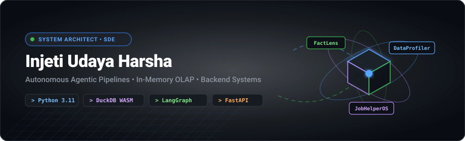

  

  
  

### 👨‍💻 About Me
Computer Science graduate focused on building scalable backend architectures, high-throughput data processing engines, and autonomous multi-agent pipelines. Experienced in designing modular REST APIs in Python/FastAPI, executing in-memory analytical queries with DuckDB, and engineering event-driven webhook synchronizations.

### 🚀 Key Projects

| Project | Tech Stack | Highlights | Links |
| :--- | :--- | :--- | :--- |
| **FactLens** | `LangGraph`, `Python`, `SQL` | Autonomous verification pipeline orchestrating 12 specialized agents for multi-source claim verification with SQLite telemetry. | [Repository](https://github.com/injetiharsha/fact-lens-lablab) · [Live Demo](https://injetiharsha.github.io/factlens/) |
| **Data Profiler** | `Python`, `DuckDB`, `FastAPI` | High-throughput in-memory engine validating 15+ column invariant rules on 100K+ records with sub-second execution. | [Repository](https://github.com/injetiharsha/data-profiler) · [Live Demo](https://injetiharsha.github.io/data_profiler/) |
| **Job Helper OS** | `Python`, `Webhooks`, `REST APIs` | Automated status updater syncing 317+ live records to Notion databases via asynchronous workers and regex payload sanitization. | [Repository](https://github.com/injetiharsha/job-helper) · [Live Demo](https://injetiharsha.github.io/job_helper/) |

### 🛠️ Technical Arsenal
* **Languages**: Python, TypeScript, SQL, C, C#
* **Backend & APIs**: FastAPI, REST APIs, Webhooks, Pydantic, HTTP, JSON Schema
* **Databases & Storage**: DuckDB, PostgreSQL, SQLite, Pandas, Ingestion Pipelines
* **Agentic AI & Orchestration**: LangGraph, Multi-Agent Systems, LLM APIs (Gemini, Claude, GPT)
* **DevOps & Practices**: Git, GitHub Actions, Linux, Docker, Bash, PyTest, Automated Testing
